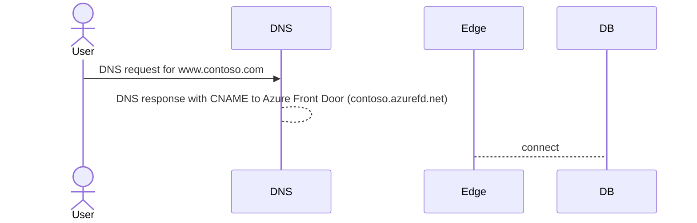

> [!WARNING]
> Historical working notes, not a verified deployment runbook. Commands can create or delete billable Azure resources. Review names, parameters and prerequisites before running them.

## Azure Frontdoor Endpoints

based on https://learn.microsoft.com/en-us/rest/api/frontdoorservice/azurefrontdoorstandardpremium/check-endpoint-name-availability/check-endpoint-name-availability?view=rest-frontdoorservice-azurefrontdoorstandardpremium-2023-05-01&tabs=HTTP

```bash
az login
prefix=cptdazfd
token=$(az account get-access-token --output tsv --query accessToken)
subid=$(az account show --output tsv --query id)
http POST https://management.azure.com/subscriptions/$subid/resourceGroups/$prefix/providers/Microsoft.Cdn/checkEndpointNameAvailability?api-version=2023-05-01 name=cptdazfds type=Microsoft.Cdn/Profiles/AfdEndpoints autoGeneratedDomainNameLabelScope=TenantReuse Authorization:'Bearer '$token

https://management.azure.com/subscriptions/f474dec9-5bab-47a3-b4d3-e641dac87ddb/resourceGroups/cptdazfds/providers/Microsoft.Cdn/checkEndpointNameAvailability?api-version=2023-05-01

checkEndpointNameAvailability
```
> [NOTE] If yo like to use a script to create the endpoint name for your azure frontdoor you can usse the terraform example at github/cpinotossi/cptdtz

-------------------------------------------------------------

## How to Go Live

Azure Front Door delivers your content using Microsoft’s global edge network with hundreds of global and local points of presence (PoPs) distributed around the world close to both your enterprise and consumer end users.

In general a User request flow for www.contoso.com would looks like this:

1. Client does request https://www.contoso.com via an internet browser.
2. DNS request for www.contoso.com is sent to the DNS server.
3. DNS server responds with a CNAME to Azure Front Door (contoso.azurefd.net).


custom domain to your Front Door. When you use Azure Front Door for application delivery, a custom domain is necessary if you want your own domain name to be visible in your end-user request. Having a visible domain name can be convenient for your customers and useful for branding purposes.

After you create a Front Door profile, the default frontend host is a subdomain of azurefd.net. This name is included in the URL for delivering Front Door content to your backend by default. For example, https://contoso-frontend.azurefd.net. For your convenience, Azure Front Door provides the option to associate a custom domain to the endpoint. With this capability, you can deliver your content with your URL instead of the Front Door default domain name such as, https://www.contoso.com/photo.png.

### Point to your configuration
Next, you need to change the existing DNS record for your site or application to be a CNAME record that points to the ​Akamai​ edge hostname. This will reroute requests for your site or app to the ​Akamai​ edge network.

Make note of the existing DNS entries for use in troubleshooting.

Before
Here's an example of a generic DNS record for a domain, before you move it to the ​Akamai​ edge network. In it, 111.222.3.4 represents the IP address for your origin server:

docsassociates.com. IN A 111.222.3.4
After
Here's an example of that same domain in a DNS record, pointing to ​Akamai​'s Standard TLS network:

docsassociates.com. IN CNAME docsassociates.com.edgesuite.net
How long does the DNS change take?
The update to your DNS needs to apply before edge network delivery will start. This depends on the time to live (TTL) you've set for your site's DNS record. In most environments, this is set to one day by default. So, it could take up to 24 hours to reroute requests. To shorten this:

Reduce your DNS TTL before you change to the ​Akamai​ edge.
Revert it back after the change.
You can switch your website or application to the edge network at any time after completing the activation steps and testing. No additional activation or monitoring is required.

Troubleshooting
If you notice a problem after switching your content to the production network:

Roll back the DNS change to point your website or application back to your servers.
Report the problem to ​Akamai​.
This helps you and ​Akamai​ identify the problem in a controlled environment without affecting live end users.

## MISC

## Frontdoor Kusto Queries

Get HITs
```Kusto
AzureDiagnostics
| where ResourceProvider == "MICROSOFT.CDN" and Category == "FrontDoorAccessLog"
| summarize Count = count() by cacheStatus_s
```
Top 10 URLs bei volume

```Kusto
//  [Azure Front Door Standard/Premium] Top 10 URL request count
//  Show egress from AFD edge by URL. Change bins resolution from 1hr to 5m to get real time results.
AzureDiagnostics
| where ResourceProvider == "MICROSOFT.CDN" and Category == "FrontDoorAccessLog"
| summarize ResponseBytes = sum(toint(responseBytes_s)) by requestUri_s
```
Top 10 URLs bei hits

```Kusto
//  [Azure Front Door Standard/Premium] Top 10 URL request count
//  Show egress from AFD edge by URL. Change bins resolution from 1hr to 5m to get real time results.
AzureDiagnostics
| where ResourceProvider == "MICROSOFT.CDN" and Category == "FrontDoorAccessLog"
| summarize ResponseBytes = sum(count() by cacheStatus_s) by requestUri_s
```AzureDiagnostics
| where ResourceProvider == "MICROSOFT.CDN" and Category == "FrontDoorAccessLog"
| extend ParsedUrl = parseurl(requestUri_s)
| summarize RequestCount = count() by Extension = extract(@"\.([a-zA-Z0-9]+)$", 1, tostring(ParsedUrl.Path))
| order by RequestCount desc

### Azure CLI

```powershell
# Add vm to lb backend pool
az network nic ip-config address-pool add --address-pool $prefix --ip-config-name $prefix --nic-name $prefix -g $prefix --lb-name $prefix
```
### curl

```bash
# dns spoofing via curl
curl -v -H"X-Azure-DebugInfo: 1" http://$fdfqdn/azure.html --resolve $fdfqdn:80:$fdip # expect 200 ok
https://chpinoto.blob.core.windows.net/test/test.txt
curl -v -H"X-Azure-DebugInfo: 1" -I http://www1.cptdazfd.org/test/test.txt  # expect 301 redirect
curl -v -H"X-Azure-DebugInfo: 1" -I https://www1.cptdazfd.org/test/test.txt  # expect 200 ok
curl -v -H"X-Azure-DebugInfo: 1" https://www1.cptdazfd.org/test/test.txt  # expect 200 ok
curl -v -H"X-Azure-DebugInfo: 1" http://cptdazfd.org/test/test.txt  # expect 200 ok
```
### wsl time sync
```bash
sudo hwclock -s
sudo ntpdate time.windows.com
```
### change chmod at wsl

Based on
- https://stackoverflow.com/questions/46610256/chmod-wsl-bash-doesnt-work
- https://devblogs.microsoft.com/commandline/automatically-configuring-wsl/

```bash
sudo cat /etc/wsl.conf
sudo touch /etc/wsl.conf
sudo nano /etc/wsl.conf
```Add
```text
[automount]
options = "metadata"
```
```bash
# chmod does not work straight away at WSL.
ls -la azbicep/ssh/chpinoto.key # should be -rwxrwxrwx
sudo chmod 600 azbicep/ssh/chpinoto.key
ls -la azbicep/ssh/chpinoto.key # should be -rw------- now
```
### github
```bash
gh repo create $prefix --public
git init
git remote remove origin
git remote add origin https://github.com/cpinotossi/$prefix.git
git remote
git submodule add https://github.com/cpinotossi/azbicep
git submodule init
git submodule update
git submodule update --init
git status
git add .gitignore
git add *
git commit -m"azure frontdoor private link demo update cptdazfd"
git push origin main
git push --recurse-submodules=on-demand
git rm README.md # unstage
git --help
git config advice.addIgnoredFile false
git pull origin main
git merge
origin main
git config pull.rebase false
git init
gh repo create cptdafd --public
git remote add origin https://github.com/cpinotossi/cptdafd.git
git status
git add *
git commit -m"Demo of custom domains and multi origin via http. Version with some hick ups which are mentioned inside the readme docs."
git log --oneline --decorate // List commits
git tag -a v1 e1284bf //tag my last commit
git push origin master

git tag //list local repo tags
git ls-remote --tags origin //list remote repo tags
git fetch --all --tags // get all remote tags into my local repo

git log --pretty=oneline //list commits

git checkout v1
git switch - //switch back to current version
co //Push all my local tags
git push origin <tagname> //Push a specific tag
git commit -m"not transient"
git tag v1
git push origin v1
git tag -l
git fetch --tags
git clone -b <git-tagname> <repository-url>

# Update user
git config --global user.name "Your Name"
git config --global user.email you@example.com
```
