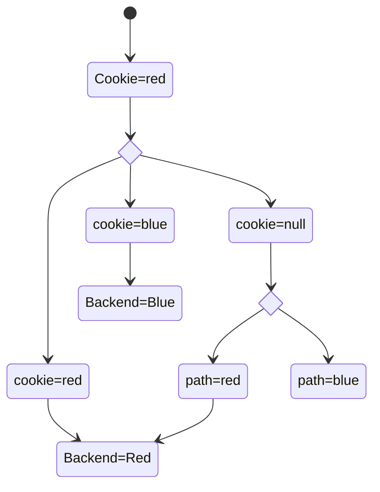

> [!WARNING]
> Historical working notes, not a verified deployment runbook. Commands can create or delete billable Azure resources. Review names, parameters and prerequisites before running them.

## Frontdoor and Traffic Manager Demo

```bash
prefix=cptdazfd
location=eastus
myip=$(curl ifconfig.io) # Just in case we like to whitelist our own ip.
myobjectid=$(az ad user list --query '[?displayName==`ga`].id' -o tsv) # just in case we like to assing

az group delete -n $prefix --yes
az group create -n $prefix -l $location
az deployment group create -n $prefix -g $prefix --mode incremental --template-file deploy.bicep -p prefix=$prefix myobjectid=$myobjectid location=$location myip=$myip
```
## Two Origins one Hostname Demo

> IMPORTANT: This demo does include DNS settings which are done under an already exisiting DNS zone.
You will need to create your Azure public DNS zone already beforehand and replace the cptdev.com .

Define certain variables which we will need.

```text
prefix=cptdafd
rg=${prefix}
myobjectid=$(az ad user list --query '[?displayName==`ga`].objectId' -o tsv)
myip=$(curl ifconfig.io)
```
Create the azure resources.

```text
az group create -n $rg -l eastus
az deployment group create -n create-vnet -g $rg --template-file bicep/deploy1.bicep -p myobjectid=$myobjectid myip=$myip
```
The following steps are a workaround because I did not manage to assigne the azure front door rules during the initial deployment.

```text
rulesid=$(az network front-door rules-engine show -f $prefix -g $rg -n $prefix --query id -o tsv)
az network front-door routing-rule update -f $prefix -g $rg -n ${prefix}routing --rules-engine $rulesid
az network front-door routing-rule show -f $prefix -g $rg -n ${prefix}routing --query rulesEngine.id -o tsv
```
> TODO: Need to figure out how to get this done already during the first deployment instead of having to call azure cli afterwards.

### Test

RuleEngine is setup as follow.


yelow.de waf test
```pwsh
curl -H"user-agent: megaindex.ru" -H"X-Azure-DebugInfo: 1" -v https://www.yello.de/erik2024.html -o output.txt
```
Test are done via curl. Because we use azure front door all test can be done via the public internet.

```text
fep=${prefix}fep
host=$(az network front-door frontend-endpoint show -g $rg -n $fep -f $prefix --query frontendEndpoints[] --query hostName -o tsv)
echo $host
curl -v -H"X-Azure-DebugInfo: 1" http://$host/
curl -v -H"X-Azure-DebugInfo: 1" http://$host/hello/blue.test
curl -v -H"X-Azure-DebugInfo: 1" http://$host/hello/blue/
curl -v -H"X-Azure-DebugInfo: 1" http://$host/red/
curl -v -H"cookie: red=true" -H"X-Azure-DebugInfo: 1" http://$host/
curl -v -H"cookie: red=true" -H"X-Azure-DebugInfo: 1" http://$host/red/
curl -v -H"cookie: red=true" -H"cookie: blue=true" -H"X-Azure-DebugInfo: 1" http://$host/
curl -v -H"cookie: blue=true" -H"cookie: red=true" -H"X-Azure-DebugInfo: 1" http://$host/
curl -v -H"X-Azure-DebugInfo: 1" http://$host/red
curl -v -H"X-Azure-DebugInfo: 1" http://$host/red.test
```
> NOTE: All test are done via HTTP, not via TLS/HTTPS. That is because self signed certificates are not supported at the backend via azure front door. But our backend´s are setup with self signed server certificates.

Each of the test should result into an 200 OK.
In case you receive 503 Service Unavailable, this could be because one of the three VMs at the backend did not load the cloud-init file correctly. This did happen several times during my testing.

> TODO: Need to consider to replace the vm based backend through azure kubernetes services.

### Clean up

Delete DNS entries first.

> NOTE: You will need to delete the DNS records first otherwise you will not be able to delete azure front door.

```text
echo $rg
az network dns zone list -g ga-rg
az network dns record-set cname list -g ga-rg -z cptdev.com -o table
az network dns record-set cname delete -g ga-rg -z cptdev.com -n afdverify.cptdafdblue -y
az network dns record-set cname delete -g ga-rg -z cptdev.com -n afdverify.cptdafdred -y
az network dns record-set cname list -g ga-rg -z cptdev.com -o table
```
Delete the azure front door setup.

```text
az group delete -n $rg -y
```
### TODO

Get it done with resource script instead like here:
https://github.com/Azure/azure-quickstart-templates/blob/master/quickstarts/microsoft.storage/storage-static-website/scripts/enable-static-website.ps1

[Bicep Script Resource](https://docs.microsoft.com/en-us/azure/templates/microsoft.resources/deploymentscripts?tabs=bicep)
