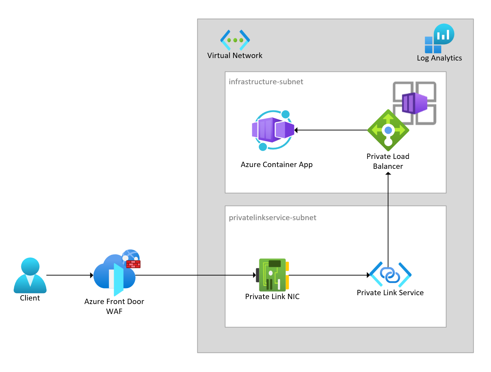

## Project status

Status: experimental scenario with an existing walkthrough. Local Bicep
compilation is available; cloud deployment has not been reverified.
See the [project catalog](../../README.md) and the additional
[historical walkthrough](docs/walkthrough.md).

Run the deployment commands below from this project directory:

```bash
cd projects/containerapp
```

Review the demo credentials and environment-specific parameters in
[deploy.sh](deploy.sh) before using it. Do not use the example credentials
for a real environment.
Set `VPN_SHARED_KEY` in your local shell before running the script; the key is
required and must not be stored in tracked files.

### Overview

Many customers require Web Applications & APIs to only be accessible via a private IP address with a Web Application Firewall on the internet edge, to protect from common exploits and vulnerabilities. Azure Container Apps ingress can be exposed on either a Public or Private IP address. One option is to place Azure Front Door in front of an ACA public endpoint, but currently there is no way (other than in application code) to restrict access to the ACA public IP address from a single Azure Front Door instance. Azure App Service Access restrictions supports this scenario, but unfortunately, there is currently no equivalent access restriction for Azure Container Apps.

To work around this limitation, Azure Private Link Service can be provisioned in front of an internal ACA load balancer. A Private endpoint (NIC with private IP in a virtual network) is connected to the Private Link Service and an Azure Front Door Premium SKU instance can then be used to connect to the private endpoint (known as a Private Origin in AFD). This configuration removes the need to inspect the value of the "X-Azure-FDID" header sent from AFD since only a single AFD instance is connected to the private endpoint, guaranteeing traffic to the ACA environment occurs only from that specific AFD instance. The overall architecture is captured in the diagram below.



### Prerequisites

- Azure subscription
- Ensure either the [AZ CLI](https://learn.microsoft.com/en-us/cli/azure/install-azure-cli) or [Azure PowerShell](https://learn.microsoft.com/en-us/powershell/azure/install-az-ps) module are installed

### Deployment

~~~bash
# path /azure-iac-examples/bicep/aca-internal-front-door-integration
chmod +x ./deploy.sh
./deploy.sh germanywestcentral cptdazfd

prefix='cptdazfd2'
az afd origin show --origin-group-name $prefix --origin-name $prefix --profile-name $prefix -g $prefix --query "{hostName:hostName, originHostHeader:originHostHeader, privateLink:sharedPrivateLinkResource.privateLink.id}" | sed -e "s#subscriptions\/.*\/resourceGroups#rg#"
fdori=$(az afd origin show --origin-group-name $prefix --origin-name $prefix --profile-name $prefix -g $prefix --query hostName)
# retrieve AFD FQDN
fdep=$(az afd endpoint show --endpoint-name $prefix --profile-name $prefix -g $prefix --query hostName -o tsv)
curl -v https://$fdep
curl -o /dev/null -s -w "%{http_code}\n" -I https://$fdep # HTTP 403

vmid=$(az vm show -g $prefix -n $prefix --query "id" -o tsv)
az network bastion ssh -n $prefix -g $prefix --target-resource-id $vmid --auth-type AAD
curl --resolve cptdazfd2.yellowmeadow-e89cfb6d.germanywestcentral.azurecontainerapps.io:443:10.1.0.62 https://cptdazfd2.yellowmeadow-e89cfb6d.germanywestcentral.azurecontainerapps.io

# get private link service ip
az network private-link-service show -g $prefix -n $prefix
 --query "loadBalancerFrontendIpConfigurations[0].privateIpAddress" -o tsv


# show container app
az containerapp show -n $prefix -g $prefix
 --query "properties.ingressConfig.ingressEndpoints[0].publicIpAddress" -o tsv
~~~

### Links
- [This repo is based on](https://github.com/cbellee/azure-iac-examples/blob/main/bicep/aca-internal-front-door-integration/README.md)
- [Blog to the repo it is based on](https://techcommunity.microsoft.com/t5/fasttrack-for-azure/integrating-azure-front-door-waf-with-azure-container-apps/ba-p/3729081)
- [Networking in Azure Container Apps environment](https://learn.microsoft.com/en-us/azure/container-apps/networking?tabs=workload-profiles-env%2Cazure-cli#dns)
- [Private linking an Azure Container App Environment](https://dev.to/kaiwalter/preliminary-private-linking-an-azure-container-app-environment-3cnf)

## Local validation

From the repository root:

```bash
az bicep build --file projects/containerapp/main.bicep --stdout > /dev/null
bash -n projects/containerapp/deploy.sh
```

The deployment script includes HTTP checks and private endpoint approval.
These checks require deployed resources and are not part of local validation.

## Cleanup and costs

Container Apps, VM, Bastion, networking and Front Door Premium can incur charges.
After reviewing the resource group name, delete the dedicated demo resource
group and any DNS records you created outside it. There is no cleanup workflow
for this project.
