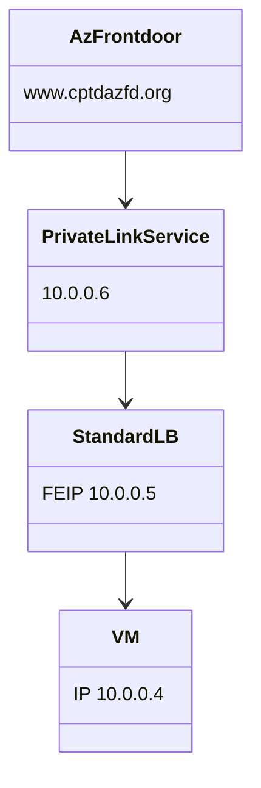

> [!WARNING]
> Historical working notes, not a verified deployment runbook. Commands can create or delete billable Azure resources. Review names, parameters and prerequisites before running them.

Run template commands from `projects/frontdoor-private-link/`. See the
[project entry points and known blockers](../README.md) before deployment.

## Frontdoor and Private Link

Setup Azure Frontdoor with Private Link and Internal Loadbalancer:

### Setup Env:

```powershell
# Define some env variables
$prefix="cptdazfd"
$location="germanywestcentral"
$myIp=(Invoke-RestMethod -Uri "http://ipv4.icanhazip.com").Trim()
# myobjectid=$(az ad user list --query '[?displayName==`ga`].id' -o tsv)
$myObjectId=az ad signed-in-user show --query id -o tsv

# az group delete -n $prefix --yes
az group create -n $prefix -l $location
# Create App Domain
# az deployment group create -n ${prefix}-domain -g $prefix --mode incremental --template-file ../../external/azbicep/bicep/appDomain.bicep -p prefix="cptdazfd2"

# Create base components
az deployment group create -n ${prefix}-base -g $prefix --mode incremental --template-file deploybase.bicep -p prefix=$prefix myobjectid=$myObjectId location=$location

# Add AFD
az deployment group create -n ${prefix}-afd -g $prefix --mode incremental --template-file deployafd.bicep -p prefix=$prefix
# You will need to approve the the Domain Registration for the new domain cptdazfd.org either via the Azure Portal or via the Rest API   "https://management.azure.com/subscriptions/$subscriptionId/resourceGroups/$resourceGroupName/providers/Microsoft.DomainRegistration/domains/$domainName?api-version=2023-12-01"

# Approve Private Link Service
$plsid=az afd origin show --origin-group-name $prefix --origin-name $prefix --profile-name $prefix -g $prefix --query sharedPrivateLinkResource.privateLink.id -o tsv
$pecid=az network private-endpoint-connection list --id $plsid --query [0].id -o tsv
az network private-endpoint-connection approve -d $prefix --id $pecid
```
### Approve Domain Registration (NOT WORKING)

To finsh the setup with our own Domain we will need to approve the domain registration via the Powershell script.

```powershell
# Define variables
$subscriptionId = "your-subscription-id"
$resourceGroupName = "your-resource-group"
$domainName = "cptdazfd2"
$token = (Get-AzAccessToken).Token

# Define the request body
$requestBody = @{
    location = "global"
    properties = @{
        privacy = $true
        autoRenew = $true
        contactAdmin = @{
            email = "admin@myedge.org"
            nameFirst = "Admin"
            nameLast = "MyEdge"
            phone = "+49.1234567890"
        }
        contactBilling = @{
            email = "admin@myedge.org"
            nameFirst = "Admin"
            nameLast = "MyEdge"
            phone = "+49.1234567890"
        }
        contactRegistrant = @{
            email = "admin@myedge.org"
            nameFirst = "Admin"
            nameLast = "MyEdge"
            phone = "+49.1234567890"
        }
        contactTech = @{
            email = "admin@myedge.org"
            nameFirst = "Admin"
            nameLast = "MyEdge"
            phone = "+49.1234567890"
        }
    }
} | ConvertTo-Json -Depth 10

# Make the API request
$subid=az account show --query id -o tsv
$domainName="${prefix}2.org"
az rest --method put --url "https://management.azure.com/subscriptions/$subid/resourceGroups/$prefix/providers/Microsoft.DomainRegistration/domains/$domainName" --url-parameters "api-version=2023-12-01" -b $requestBody --headers "ContentType"="application/json" --verbose
az rest --method put --url "https://management.azure.com/subscriptions/$subid/resourceGroups/$prefix/providers/Microsoft.DomainRegistration/domains/$domainName" --url-parameters "api-version=2023-12-01" -b "{}" --headers "ContentType"="application/json" --verbose

$response = Invoke-RestMethod -Method Put -Uri "https://management.azure.com/subscriptions/$subscriptionId/resourceGroups/$resourceGroupName/providers/Microsoft.DomainRegistration/domains/$domainName?api-version=2023-12-01" -Headers @{ Authorization = "Bearer $token" } -Body $requestBody -ContentType "application/json"

# Output the response
$response
```
### Validate Custom Domain for Azure Frontdoor

```powershell
# Define variables
$prefix="cptdazfd"
customDomainName="www.${prefix}.org" # Replace with your custom domain name

# Lookup if our custom domain is already validated
az afd custom-domain list -g $prefix --profile-name $prefix
# Get the validation token
$validationToken=az afd custom-domain list -g $prefix --profile-name $prefix --query "[?domainValidationState=='Pending']| [0].validationProperties.validationToken" -o tsv
# List all TXT records for the custom domain
az network dns record-set txt list -g $prefix -z "${prefix}.org"
# create new txt record with the validation token
az network dns record-set txt add-record -g $prefix -z "${prefix}.org" -n "_dnsauth.www.${prefix}.org" -v $validationToken
az network dns record-set txt list -g $prefix -z "${prefix}.org"
az afd custom-domain show -g $prefix --profile-name $prefix --custom-domain-name "www-cptdazfd-org"
"www-${prefix}-org"
az afd custom-domain show -g $prefix --profile-name $prefix --custom-domain-name "cptdazfd-cfgzcvcdh9bzbdfv.b01.azurefd.net"

 --query "validationProperties.validationToken" -o tsv)

# Output the validation token
echo "Validation Token: $validationToken"
```
### Verify setup

```bash
az vm list-ip-addresses -g $prefix -n $prefix -o tsv # expect 10.0.0.4 for our vm
# proof we are using only privat ips with our lb
az network lb show -n $prefix -g $prefix --query frontendIPConfigurations[].privateIPAddress -o tsv # expect 10.0.0.5
# what is the ip of our private link service?
az network private-link-service show -n $prefix -g $prefix --query ipConfigurations[].privateIPAddress -o tsv # expect 10.0.0.6
# Get details about our AFD profile
az afd origin show --origin-group-name $prefix --origin-name $prefix --profile-name $prefix -g $prefix --query "{hostName:hostName, originHostHeader:originHostHeader, privateLink:sharedPrivateLinkResource.privateLink.id}"

# Show effective routes of nic
az network nic show-effective-route-table -g $prefix -n $prefix -o table
# Show effective security rules of nic
az network nic list-effective-nsg -g $prefix -n $prefix -o table

```
### Setup Web Server at VM

```bash
# ssh into vm
$vmid=az vm show -g $prefix -n $prefix --query id -o tsv
az network bastion ssh -n $prefix -g $prefix --target-resource-id $vmid --auth-type AAD
az network bastion ssh -n $prefix -g $prefix --target-resource-id $vmid --auth-type password --username chpinoto
# Create web server
mkdir www
cd www
echo "hello world" > index.html
echo "hello azure" > azure.html
netstat -tuln | grep ':9000' # check if port 9000 is already in use
python -m SimpleHTTPServer 9000
python -m SimpleHTTPServer 9000 &

# Optional: Start web server in background
nohup python -m SimpleHTTPServer 9000 > log.txt 2>&1 &
# verify logs
tail log.txt
curl http://localhost:9000
curl http://10.0.0.5/azure.html
ping 10.0.0.5
# kill prozess
sudo kill -9 `sudo lsof -t -i:9000`
nohup --help
```
### Test

Open new terminal (CTL+SHIFT+ö at VSCode with German Keyboard) and test the setup as follows:

```bash
$prefix="cptdazfd" #you need to set the ENV var again

# retrieve AFD FQDN
$fdfqdn=az afd endpoint show --endpoint-name $prefix --profile-name $prefix -g $prefix --query hostName -o tsv # expect <Your prefix>-<Random>.b01.azurefd.net
# retrieve AFD custom domains
$fdcd0=az afd custom-domain list -g $prefix --profile-name $prefix --query [0].hostName -o tsv # expect www.<your prefix>.org
$fdcd1=az afd custom-domain list -g $prefix --profile-name $prefix --query [1].hostName -o tsv

curl -v -k http://$fdfqdn/index.html # expect 200 ok and hello world
curl -v -k https://$fdfqdn/index.html # expect 200 ok and hello world

curl -v -k http://$fdcd0/index.html # expect 200 ok and hello world
curl -v -k https://$fdfqdn/index.html # expect 200 ok and hello world

curl -v -k http://$fdcd0/index.html # expect 200 ok
curl -v -k http://$fdcd0/azure.html # expect 200 ok

curl -v -k https://$fdfqdn/index.html # expect 200 ok
curl -v -k https://$fdfqdn/azure.html # expect 200 ok

curl -v -H"X-Azure-DebugInfo: 1" https://$fdcd0/azure.html # expect 200 ok

curl -v -H"X-Azure-DebugInfo: 1" https://cptdaztest-d9a5ahg2c3bffufd.b01.azurefd.net/azure.html # expect 200 ok
curl -v  https://cptdaztest-d9a5ahg2c3bffufd.b01.azurefd.net/azure.html # expect 200 ok

# retrieve AFD Edge PoP IP
fdip=$(dig $fdfqdn +short | tail -n1)
echo $fdip

dig cptdazfd.cptdev.com
traceroute cptdazfd.cptdev.com
curl ipinfo.io/$fdip

curl https://cptdazfd.cptdev.com/index.html
curl https://cptdazfd-cfgzcvcdh9bzbdfv.z01.azurefd.net/azure.html
curl -v "https://cptdazfd-cfgzcvcdh9bzbdfv.z01.azurefd.net/azure.html?cache"
curl -v http://cptdev.com/azure.html

dig cptdazfd-cfgzcvcdh9bzbdfv.z01.azurefd.net
dig cptdev.com
```
- X-Azure-OriginStatusCode
 - This header contains the HTTP status code returned by the backend. Using this header you can identify the HTTP status code returned by the application running in your backend without going through backend logs. This status code might be different from the HTTP status code in the response sent to the client by Front Door. This header allows you to determine if the backend is misbehaving or if the issue is with the Front Door service.
- X-Azure-InternalError	This header will contain the error code that Front Door comes across when processing the request. This error indicates the issue is  internal to the Front Door service/infrastructure. Report issue to support.
- X-Azure-ExternalError
 - X-Azure-ExternalError: 0x830c1011, The certificate authority is unfamiliar.
 - This header shows the error code that Front Door servers come across while establishing connectivity to the backend server to process a request. This header will help identify issues in the connection between Front Door and the backend application. This header will include a detailed error message to help you identify connectivity issues to your backend (for example, DNS resolution, invalid cert, and so on.).

### Clean up
```bash
az group delete -n $prefix --yes --no-wait
```
### NOTE:
(Azure FD and SSL Certificate)[https://github.com/brwilkinson/AzureDeploymentFramework/blob/73df5f8f1dfc32415ca6d5051512edb7348a52b6/ADF/bicep/FD-frontDoor.bicep#L167]
- (Azure FD, Private Link and Container Apps)[https://github.com/sebafo/frontdoor-container-apps]
